# Catálogo de Flujos Esenciales de n8n — Autonomous Content Engine

Esta guía documenta los **5 flujos de automatización oficiales** diseñados para conectar n8n (instalado en el MiniPC en `http://localhost:5678`) con la API interna del backend (`http://ace-backend:8000/api/v1`) usando la red Docker privada `ace-net`.

> **Basado en patrones comunitarios probados:** Estructura adaptada de `enescingoz/awesome-n8n-templates` y `flowyantra/blog-to-social-ai-n8n`, manteniendo la puerta de seguridad humana (**HITL Nivel 3**).

---

## Cómo importar cualquier flujo en n8n (en 30 segundos)

1. Abre tu instancia de n8n: [http://localhost:5678](http://localhost:5678).
2. Pulsa **+ Add Workflow**.
3. En el menú superior derecho (`...`), selecciona **Import from File...** (o **Import from URL / JSON**).
4. Selecciona cualquiera de los archivos `.json` ubicados en `infra/n8n/workflows/` (o descárgalos directamente desde el **Paso 4: Publicación y Flujos n8n** en la interfaz web).
5. Activa el interruptor **Active** en la esquina superior derecha.

---

## Mapa de los 5 Flujos Necesarios

```mermaid
flowchart LR
    F1[01. Radar Matutino<br/>Cron 08:00 AM] -->|ICE >= 7.0 + Guión Ollama| STUDIO[(Studio Web<br/>& Teleprompter)]
    STUDIO -->|Grabación en Drive| F2[02. Ingesta Drive + FFmpeg<br/>Webhook Auto-Edición]
    F2 -->|Audio -14 LUFS + Subtítulos| F3[03. Alerta Móvil HITL<br/>Aviso Telegram/Email]
    F3 -->|Aprobación Humana 2FA| F4[04. Publicación Multicanal<br/>Token HMAC + Redes]
    F4 -->|A las 24h / Lunes 09:00| F5[05. Auditoría RMT-A<br/>Aprendizaje Episódico]
```

### Flujo 1: Radar Matutino de Ideas ICE y Guionización IA
- **Archivo:** `infra/n8n/workflows/01_radar_ideas_ice_matutino.json`
- **Disparador:** Programado diariamente a las **08:00 AM**.
- **Endpoints utilizados:**
  - `POST /api/v1/ideas/score-ice`
  - `POST /api/v1/projects`
  - `POST /api/v1/scripts/generate`
- **Qué hace:** Evalúa propuestas de contenido según Impacto, Confianza y Facilidad (ICE). Si la puntuación supera `7.0`, crea automáticamente el proyecto en el tablero Kanban y redacta un borrador de guión AV a dos columnas usando tu modelo local en Ollama (`qwen3:14b` / `32b`) y tu perfil de creador.

### Flujo 2: Ingesta desde Google Drive y Procesado FFmpeg (-14 LUFS)
- **Archivo:** `infra/n8n/workflows/02_ingesta_google_drive_ffmpeg.json`
- **Disparador:** Webhook `POST /webhook/ace-drive-ingest` (o nodo Trigger de Google Drive).
- **Endpoints utilizados:**
  - `POST /api/v1/media/google-drive/scan`
  - `POST /api/v1/media/google-drive/import`
- **Qué hace:** Cuando grabas un vídeo con el móvil y lo guardas en tu carpeta de Google Drive, n8n ordena al Worker del MiniPC descargarlo, eliminar los silencios largos, normalizar el audio a estándar **EBU R128 (-14 LUFS)**, generar la transcripción con Whisper y dejarlo listo para revisión en 9:16.

### Flujo 3: Alerta HITL al Móvil (Revisión antes de Publicar)
- **Archivo:** `infra/n8n/workflows/03_alerta_hitl_aprobacion_movil.json`
- **Disparador:** Webhook `POST /webhook/ace-hitl-alert`.
- **Qué hace:** Ningún agente puede publicar por su cuenta (Política **Human-in-the-Loop Nivel 3**). Cuando un vídeo termina su edición y tiene los copies preparados para YouTube, Instagram, TikTok y LinkedIn, este flujo te envía un mensaje resumido a tu **Telegram** con un enlace directo a tu Studio para que lo revises y autorices.

### Flujo 4: Publicación Multicanal Segura (Con Token HMAC)
- **Archivo:** `infra/n8n/workflows/04_publicacion_multicanal_escalonada.json`
- **Disparador:** Webhook `POST /webhook/ace-publish-approved`.
- **Endpoints utilizados:**
  - `POST /api/v1/hitl/issue-token`
  - `POST /api/v1/social/publish`
- **Qué hace:** Una vez introduces tu código de confirmación 2FA, n8n solicita el token criptográfico HMAC-SHA256 al backend y ejecuta la distribución simultánea respetando las reglas algorítmicas de cada red (p. ej., moviendo automáticamente el enlace externo al primer comentario de LinkedIn para evitar penalización de alcance).

### Flujo 5: Auditoría Semanal RMT-A y Memoria Episódica
- **Archivo:** `infra/n8n/workflows/05_auditoria_rmta_aprendizaje.json`
- **Disparador:** Programado cada **Lunes a las 09:00 AM**.
- **Endpoints utilizados:**
  - `POST /api/v1/analytics/diagnose-rmta`
- **Qué hace:** Analiza la retención a 3 segundos (Hold Rate), la tasa de finalización y los envíos por alcance (*Sends per Reach*). Registra automáticamente las lecciones aprendidas en la memoria episódica del motor (`learned_rules.md`) para que los guiones de la semana siguiente tengan mayor retención.
