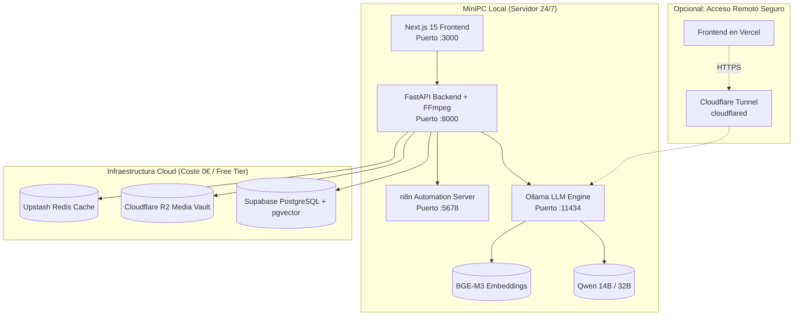

# Guía de Instalación y Despliegue Local en MiniPC (24GB / 48GB)

Esta guía documenta la infraestructura para ejecutar la plataforma **Autonomous Content Engine** en tu MiniPC local con **coste de inferencia 0€**, combinando la potencia de modelos de lenguaje abiertos (Qwen 14B / 32B y embeddings BGE-M3) con la nube híbrida (Supabase, Cloudflare R2 y Upstash).

---

## 1. Arquitectura del Stack Local



---

## 2. Requisitos de Hardware y Dimensionamiento de RAM

| Componente | Configuración Actual (24 GB RAM) | Configuración Futura (48 GB RAM) |
| :--- | :--- | :--- |
| **Modelo LLM Recomendado** | **`qwen3:14b`** (o `qwen2.5:14b`) | **`qwen3:32b`** (o `qwen2.5:32b`) |
| **Memoria del Modelo** | ~9.5 GB de RAM | ~22.0 GB de RAM |
| **Memoria Libre para SO/Apps**| ~14.5 GB libres (holgado) | ~26.0 GB libres (máximo rendimiento) |
| **Calidad de Guiones** | Excelente (supera a GPT-4o-mini) | Nivel Claude 3.5 Sonnet / GPT-4o |
| **Modelo Embeddings** | `bge-m3` (~1.2 GB) | `bge-m3` (~1.2 GB) |
| **Coste por Token** | **0,00 €** | **0,00 €** |

---

## 3. Método 1: Instalación Rápida Automática (1 Comando)

El proyecto incluye un instalador interactivo que detecta el sistema operativo, verifica Docker, comprueba la RAM disponible y descarga los modelos correspondientes de forma autónoma.

### Paso 1: Clonar o descargar el repositorio en el MiniPC
```bash
git clone https://github.com/tu-usuario/kigalcontent.git
cd kigalcontent
```

### Paso 2: Ejecutar el instalador
```bash
chmod +x setup-minipc.sh
./setup-minipc.sh
```

### ¿Qué hace el instalador automáticamente?
1. **Diagnóstico**: Detecta tu procesador, arquitectura y cantidad exacta de RAM.
2. **Docker**: Si estás en Linux (Ubuntu/Debian) y no tienes Docker, te ofrece instalarlo en un clic con el script oficial.
3. **Selección inteligente de IA**: Asigna `qwen3:14b` (para 24GB) o `qwen3:32b` (para 48GB).
4. **Variables de entorno**: Crea y sincroniza el archivo `.env` con las claves criptográficas necesarias (`HITL_HMAC_SECRET`).
5. **Despliegue Docker Compose**: Levanta los 4 contenedores (Ollama, Backend con FFmpeg, Frontend y n8n).
6. **Descarga de modelos**: Espera a que Ollama esté en línea y descarga el LLM y el modelo de embeddings BGE-M3.
7. **Verificación de salud**: Comprueba que todos los endpoints respondan correctamente.

---

## 4. Método 2: Instalación Paso a Paso Manual

Si prefieres realizar el proceso manualmente o en un servidor headless paso a paso:

### Paso 1: Instalar Docker y Docker Compose (en Ubuntu/Debian)
```bash
curl -fsSL https://get.docker.com -o get-docker.sh
sudo sh get-docker.sh
sudo usermod -aG docker $USER
# Cierra sesión y vuelve a entrar, o ejecuta:
newgrp docker
```

### Paso 2: Configurar las variables de entorno
```bash
cp .env.example .env
```
Edita `.env` para asegurar que apuntan a tus servicios:
```ini
LLM_PROVIDER=auto
OLLAMA_BASE_URL=http://ollama:11434
OLLAMA_MODEL=qwen3:14b
OLLAMA_EMBEDDING_MODEL=bge-m3

# Tus conexiones Cloud (Supabase, R2, Upstash)
DATABASE_URL=postgresql://...
S3_ENDPOINT_URL=https://...
REDIS_URL=rediss://...
```

### Paso 3: Levantar el stack Docker
```bash
docker compose -f docker-compose.minipc.yml up -d --build
```

### Paso 4: Descargar los modelos en Ollama
```bash
# Para el MiniPC con 24GB de RAM:
docker exec -it ace-ollama ollama pull qwen3:14b
docker exec -it ace-ollama ollama pull bge-m3

# O cuando amplíes a 48GB de RAM:
docker exec -it ace-ollama ollama pull qwen3:32b
```

---

## 5. Accesos y Paneles Locales

Una vez levantado el stack, todos los servicios estarán activos en tu red local:

- **Frontend Web (Next.js 15):** [http://localhost:3000](http://localhost:3000)
- **Backend API & Swagger Docs:** [http://localhost:8000/docs](http://localhost:8000/docs)
- **n8n Workflow Automation:** [http://localhost:5678](http://localhost:5678)
- **Ollama Engine:** [http://localhost:11434](http://localhost:11434)

---

## 6. Conectar Vercel con el MiniPC mediante Cloudflare Tunnel (Opcional)

Si tienes el Frontend desplegado en Vercel y quieres que utilice el modelo Qwen de tu MiniPC (ahorrando 100% de costes de API de Claude u OpenAI), puedes exponer Ollama o el Backend de forma segura con un túnel gratuito de Cloudflare:

### Paso 1: Instalar `cloudflared` en el MiniPC
```bash
curl -L --output cloudflared.deb https://github.com/cloudflare/cloudflared/releases/latest/download/cloudflared-linux-amd64.deb
sudo dpkg -i cloudflared.deb
```

### Paso 2: Autenticar e iniciar el túnel
1. Ve al panel de [Cloudflare Zero Trust](https://one.dash.cloudflare.com/) > **Networks** > **Tunnels**.
2. Haz clic en **Create a Tunnel** y dale un nombre (ej. `minipc-ace`).
3. Elige **Public Hostname**:
   - Subdominio: `ollama.tudominio.com`
   - Servicio: `HTTP` -> `localhost:11434`
4. Copia el comando de instalación que te da Cloudflare y ejecútalo en el MiniPC.

### Paso 3: Configurar Vercel
En la configuración de tu proyecto en Vercel (**Settings** > **Environment Variables**):
- Añade `OLLAMA_BASE_URL` = `https://ollama.tudominio.com`
- Añade `LLM_PROVIDER` = `ollama`
- Haz un Redeploy en Vercel. ¡Tu web pública usará la IA de tu MiniPC sin coste!

---

## 7. Automatizaciones con n8n

El contenedor de n8n viene preconfigurado en la misma red privada de Docker (`ace-net`).

1. Abre [http://localhost:5678](http://localhost:5678) en tu navegador y crea tu usuario de administrador local.
2. Puedes crear flujos que llamen a la API interna del backend usando la URL:
   `http://ace-backend:8000/api/v1/scripts/generate`
3. Casos de uso ideales:
   - Disparar la generación de 5 guiones cada mañana a las 08:00 AM.
   - Escuchar una carpeta de Google Drive y procesar automáticamente cualquier archivo de video que subas.
   - Publicar borradores a redes sociales tras la aprobación en el panel HITL.

---

## 8. Actualización a 48 GB de RAM

Cuando instales el módulo adicional de RAM en tu MiniPC:

Simplemente ejecuta:
```bash
./setup-minipc.sh --upgrade-48gb
```
El script cambiará automáticamente la configuración a `qwen3:32b`, descargará el modelo y reiniciará el servicio con el nuevo motor de alta fidelidad.

---

## 9. Comandos Frecuentes de Mantenimiento

```bash
# Ver registros de todos los contenedores en vivo
docker compose -f docker-compose.minipc.yml logs -f

# Ver registros solo de Ollama o del Backend
docker compose -f docker-compose.minipc.yml logs -f ollama
docker compose -f docker-compose.minipc.yml logs -f ace-backend

# Detener todos los servicios
docker compose -f docker-compose.minipc.yml stop

# Reiniciar todos los servicios
docker compose -f docker-compose.minipc.yml restart

# Comprobar qué modelos tiene descargados Ollama
docker exec -it ace-ollama ollama list
```
